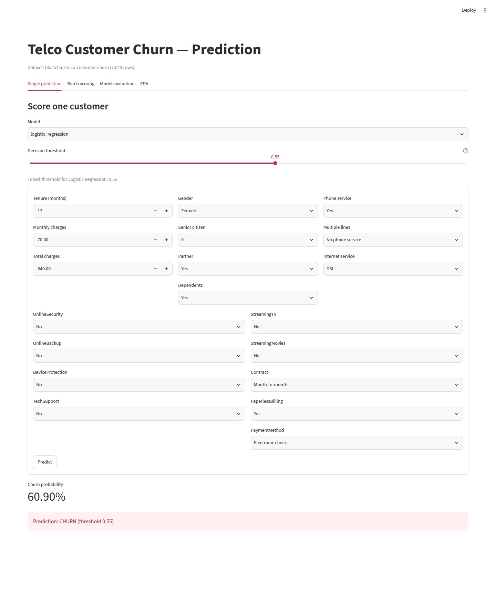
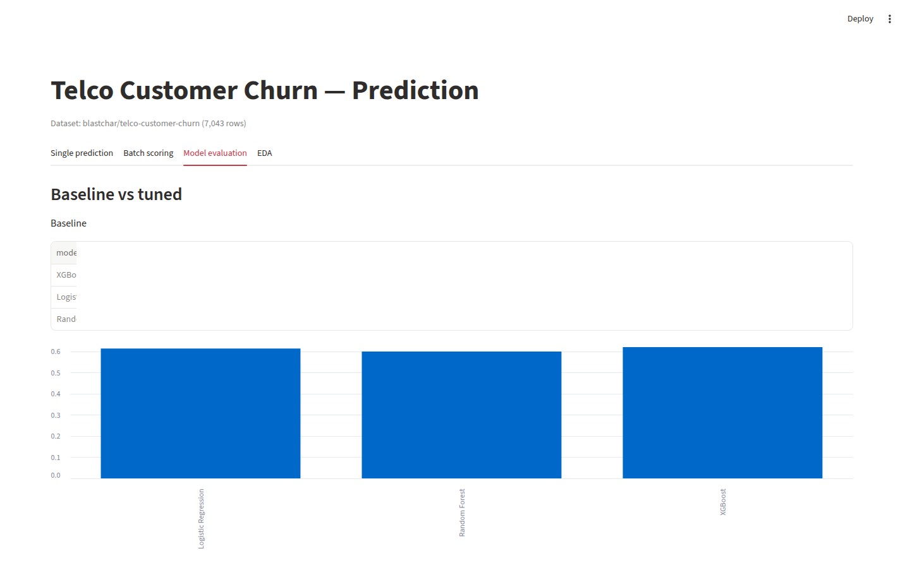
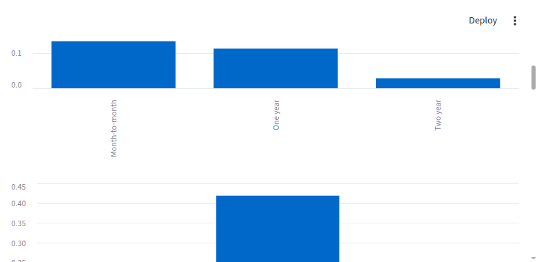

# Telco Customer Churn Prediction

Dataset: Kaggle `blastchar/telco-customer-churn` (7,043 rows, 21 columns).

## Setup

```bash
python3 -m venv .venv
.venv/bin/pip install -r requirements.txt
```

## Pipeline

```bash
.venv/bin/python eda.py                 # outputs/eda/ (4 charts + summary.md)
.venv/bin/python train.py               # baselines -> models/comparison.csv
.venv/bin/python tune.py 80             # Optuna, 80 trials/model -> models/tuned_*
.venv/bin/python predict.py xgboost 5   # score first 5 rows
streamlit run app.py                    # UI at http://localhost:8501
```

## Results (test set, 1,409 rows)

Baseline:

| Model | CV AUC | Accuracy | Precision | Recall | F1 | ROC AUC |
|---|---|---|---|---|---|---|
| XGBoost | 0.8446 | 0.7452 | 0.5131 | 0.7834 | 0.6201 | 0.8407 |
| Logistic Regression | 0.8459 | 0.7381 | 0.5043 | 0.7834 | 0.6136 | 0.8413 |
| Random Forest | 0.8368 | 0.7757 | 0.5700 | 0.6310 | 0.5990 | 0.8332 |

Tuned (80 trials/model, Optuna on out-of-fold F1 + tuned per-model threshold):

| Model | Threshold | Accuracy | Precision | Recall | F1 | ROC AUC |
|---|---|---|---|---|---|---|
| XGBoost | 0.35 | 0.7835 | 0.5723 | 0.7299 | **0.6416** | 0.8472 |
| Random Forest | 0.58 | 0.7764 | 0.5616 | 0.7193 | 0.6307 | 0.8450 |
| Logistic Regression | 0.55 | 0.7601 | 0.5349 | 0.7380 | 0.6202 | 0.8416 |

XGBoost leads on F1 (0.6416, up from 0.6201 baseline) and ROC AUC (0.8472).
LogReg/RF favor precision at their tuned thresholds. Ensemble of the three was
tested and did not beat single-model XGBoost, so the winner is persisted alone.

## Cleaning & feature engineering

- `TotalCharges`: 11 blank strings (`' '`, tenure=0) coerced to numeric + median imputed
- `Churn`: Yes/No -> 1/0; `customerID`: dropped
- Numeric: standardized; categorical: one-hot with `handle_unknown="ignore"`
- Engineered: `tenure_bin`, `avg_charge`, `n_addons` (count of value-added services),
  `fiber_month` (fiber + month-to-month), `auto_pay`, `no_internet`
- Same cleaning in `common.py` for train, predict, app — no drift

## UI

Four tabs: single prediction (threshold slider), batch CSV scoring with download,
train-vs-tuned comparison, and EDA charts.

### Screenshots

Single prediction — model, tuned threshold (0.55), scored customer:



Model evaluation — baseline vs tuned F1 comparison:



EDA — churn rates by category:


